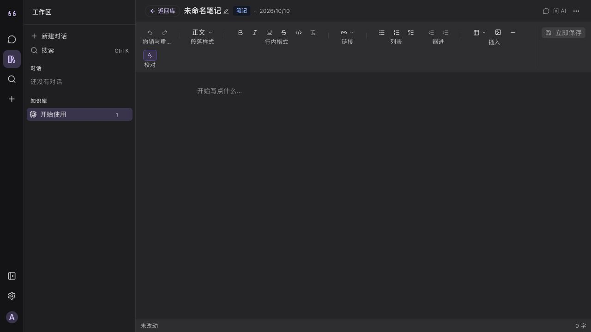
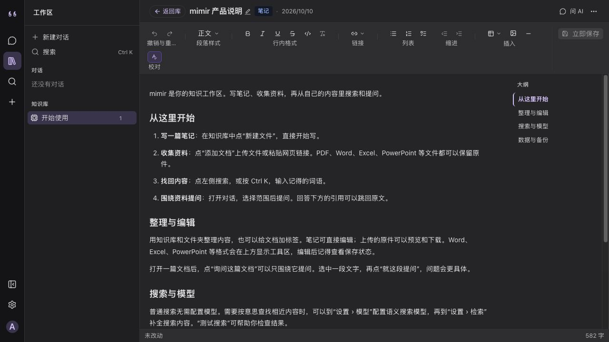
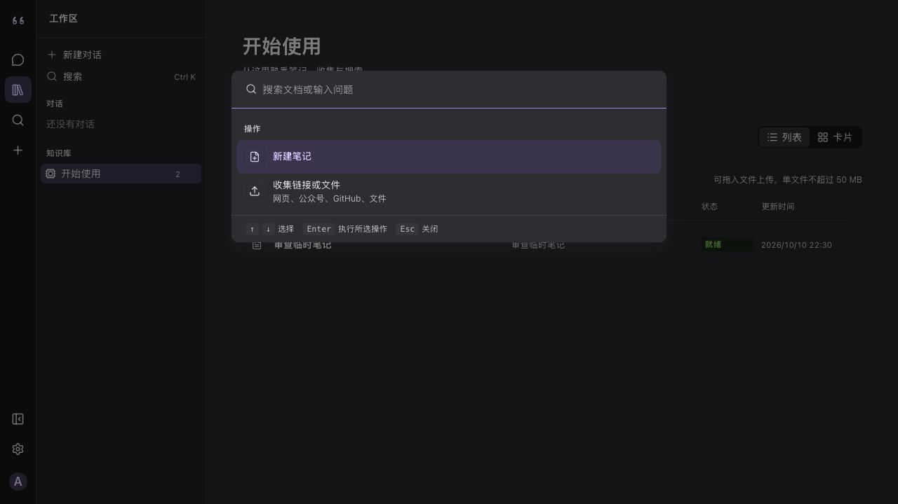
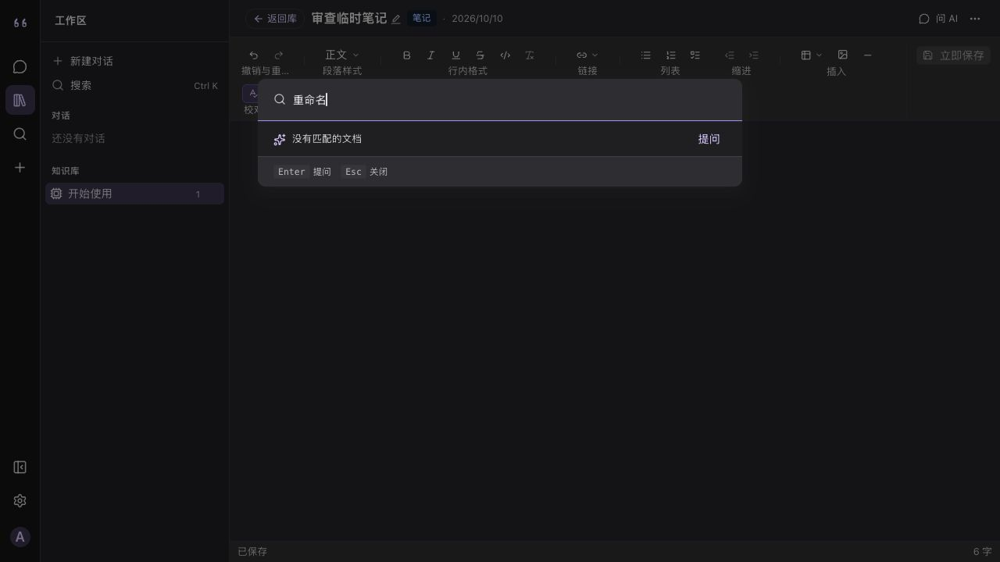
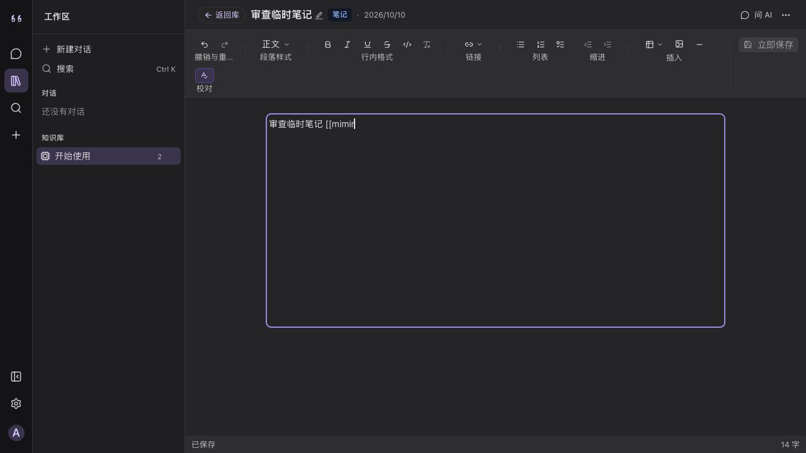
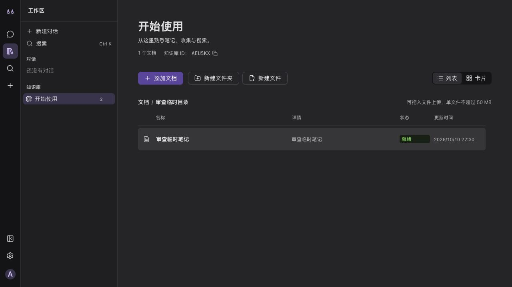
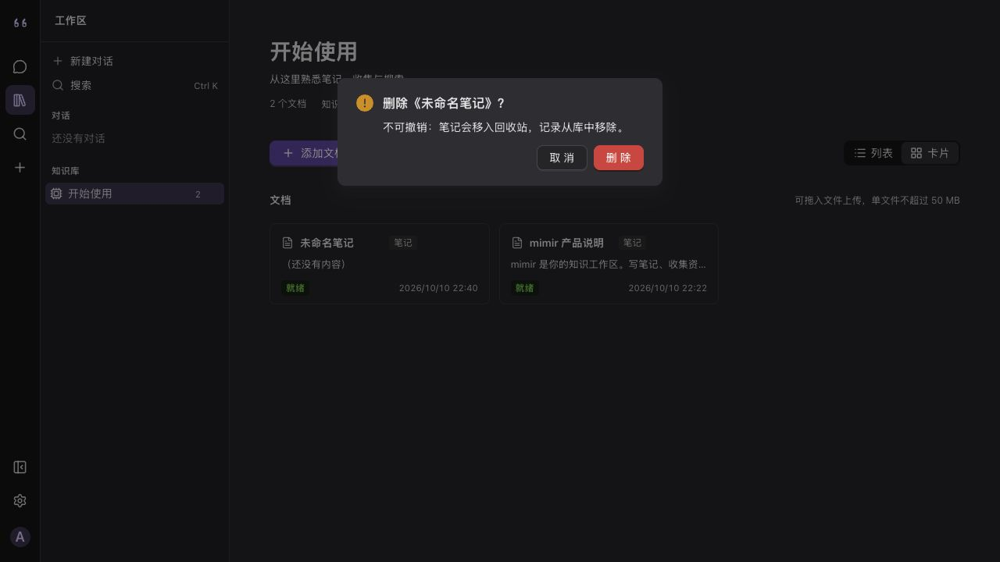

# 网页端交互细节审查 · 2026-10-10

## 范围与证据

在本地 `localhost:5173`、隔离审查账号 `audit` 下，通过浏览器实际操作登录后的导航、知识库、Markdown 笔记、搜索、收集、对话和设置。检查了默认桌面窗口及 600px 窄窗口；使用鼠标、Tab、方向键、Esc 和 macOS 快捷键。以下“问题”和“通过”均指本轮实测；代码位置仅辅助定位，不代表该路径的每种状态都已测试。截图保存在同目录 `audit/`，逐张打开核对过。

没有调用收费模型、抓取外部网址、上传私人文件或清空回收站。供应商、账号名称、S3 等表单草稿已丢弃；审查时创建的空白笔记已移入回收站，知识库恢复为原先的单文档列表视图，主题保持原有深色。另一篇用于保存测试的临时笔记也已移入回收站。[恢复后的知识库](audit/13-restored-state.png)。导出生成的临时 ZIP 与 JSON 在校验后已删除。

## 操作矩阵

| 流程 | 实际操作与状态 | 结论 |
| --- | --- | --- |
| 全局导航 | 点击知识库、搜索、收集、设置与已有对话；展开账号主题菜单并跨页 | **问题**：主题子菜单跨页残留，见 F3 |
| 全局搜索 | `Ctrl K` 打开并聚焦，输入后方向键选择、Esc 和外点击关闭 | **通过**：选择和关闭有效，焦点回搜索按钮 |
| 知识库切换 | 列表／卡片切换、方向键操作卡片、复制知识库 ID | **通过**：键盘可切换，复制有反馈 |
| 新建知识库／文件夹 | 空白名称、取消与关闭；文件夹弹窗按 Esc | **通过**：空白提交被禁用，取消后无残留；Esc 后焦点回“新建文件夹”按钮 |
| 新建笔记 | 点击“新建文件”、返回、从卡片操作删除本轮空白测试笔记 | **通过**：新笔记可创建，清理后文档数恢复为 1 |
| 添加文档 | 展开四项菜单、Esc 关闭；从“网页抓取”进入知识库范围的收集弹窗；上传页签用方向键和 Tab | **问题**：知识库入口关闭收集弹窗后焦点落在 `BODY`，见 F7；[上传入口](audit/20-capture-upload-entry.png)可通过键盘到达，未选择文件 |
| 知识库重命名 | 进入后取消 | **问题**：关闭后焦点落在页面 `BODY`，见 F7 |
| 卡片操作 | 600px 截图观察默认可见性，键盘焦点路径 | **风险**：默认隐藏操作，只在 hover／focus-within 显示；真实触屏未测，见 F9 |
| Markdown 编辑 | 输入、自动保存状态、撤销／重做／加粗快捷键、工具菜单 Esc；未保存确认的三个选项 | **问题**：丢弃后仍保存，且 macOS 快捷键提示不符，见 F1、F2；“继续编辑”返回原页，“保存并离开”成功，[列表结果](audit/19-save-and-leave.png) |
| 文档问 AI | 打开／关闭侧栏、查看范围控件与引导文案 | **问题**：关闭后焦点落在 `BODY`；范围文案与可选项不一致，见 F7、F10 |
| 收集 | URL 空值与格式校验、页签草稿保留、Esc 关闭、600px 布局；全局入口关闭后的焦点 | **通过**：错误地址不可继续，草稿和浮层行为正常；全局入口的焦点返回“收集”按钮；未执行抓取 |
| 对话 | 输入 `Shift+Enter` 换行、空白提问禁用态、检索过程展开、复制反馈、范围与思考强度菜单、未配置模型菜单 | **通过**：这些动作有效，Esc 可关闭菜单，模型选项明确标为未配置；未发送新模型请求，[过程截图](audit/03-chat-trace-expanded.jpg) |
| 供应商设置 | 手动模型行增删、密钥显隐、未保存退出确认、空表单保存 | **问题**：字段错误缺少程序化关联，见 F6；退出确认正常 |
| 订阅设置 | 输入无效 RSS 地址 `bad url` 并提交 | **问题**：仅有笼统请求错误，见 F4 |
| 账号设置 | 名称输入未保存草稿，切换分区再返回 | **问题**：草稿静默丢失，见 F5 |
| 检索设置 | 测试已删除笔记的独有词、正常关键词、查看已收录计数 | **问题**：计数包含已删除笔记，见 F11；已删除笔记词得到 0 条，正常词有结果 |
| 存储设置 | 展开／收起 S3 预配置、输入未保存草稿、测试当前本地存储 | **问题**：字段没有可访问名称，草稿静默丢失，见 F12、F5；[本地探测反馈](audit/18-local-storage-probe.png)正常 |
| 数据与备份 | 分别导出文档与附件、完整记录，检查下载文件 | **通过**：ZIP 完整性校验通过，含 1 篇笔记、2 条对话和 README；JSON 可解析，含 1 条文档记录与 2 条对话记录；临时文件已清理 |
| 支持能力／统计 | 查看来源与格式能力、零调用状态 | **通过**：状态可读；本账号没有用量记录，因此无图表筛选可测 |
| 600px 导航 | 打开侧边栏，点击露出的背景输入区并按 Tab；关闭后看焦点 | **问题**：背景仍可聚焦／操作，关闭后焦点落在 `BODY`，见 F8、F7 |
| 600px 设置／收集 | 设置分区下拉的键盘切换、收集浮层布局 | **通过**：可操作，未见遮挡；[收集浮层](audit/10-capture-600.jpg) |
| 登录错误、Office 编辑、真实模型调用、抓取完成、上传完成、S3 连接、真实触屏 | 本轮未执行 | **未测试**；不能从代码或截图推断结果 |

## 修复顺序

1. **P1：F1**，先修正“丢弃改动”与自动保存的矛盾。
2. **P2：F2–F8、F12–F17、F20–F21**，修正快捷键提示、菜单关闭、表单反馈与草稿保护、焦点和字段名称；提高笔记创建、切换、命令入口和互链的连续性，并重整 Markdown 编辑页头部与工具区。
3. **P3：F9–F11、F18–F19、F22**，处理触屏发现性、文案、检索计数、目录位置感、删除提示和保存反馈的重复呈现。

## 发现详情

### F1 · P1 · “丢弃改动”后仍保留刚输入的内容

在临时 Markdown 笔记输入 `丢弃校验标记XYZ`，立即点“返回知识库”；确认框出现后，后台状态已变成“已保存”，但弹窗仍让用户选“丢弃改动”。点“丢弃改动”再打开该笔记，标记仍在。[确认框与已保存状态](audit/01-unsaved-confirm-after-autosave.jpg)、[重开后的内容](audit/02-discard-reopened.jpg)。这会让用户误以为内容已撤销，影响隐私和数据控制。`packages/renderer/src/lib/unsaved.tsx:69-77` 中 `discard` 只清脏标记并导航，未回滚已完成的自动保存。建议统一自动保存与离开确认的语义：一旦写入成功，不再提供会误导用户的“丢弃”；若确需撤销，必须保存进入编辑前的版本并实现回滚。

### F2 · P2 · macOS 编辑快捷键标签与实际按键不符

编辑器显示 `Ctrl+Z`、`Ctrl+Shift+Z`、`Ctrl+B`，实测 Ctrl 组合无效，`⌘Z`、`⌘⇧Z`、`⌘B` 生效。标签在 `packages/office/src/editors/MarkdownEditor.tsx:612-656`。建议按平台显示快捷键，且让工具提示、可访问名称与实际按键一致。

### F3 · P2 · 账号主题子菜单跨页残留

展开账号菜单中的“主题”，点击左侧“设置”，菜单及子菜单仍显示；连续按 Esc、点击空白处后仍剩孤立的主题子菜单，刷新才消失。[跨页残留](audit/04-account-menu-persists.jpg)、[孤立子菜单](audit/05-orphan-theme-menu.jpg)。建议路由切换时统一关闭两层菜单，并检查 Esc、外点击后的子菜单状态与焦点恢复。代码辅助定位：`packages/renderer/src/components/NavSidebar.tsx` 的账号菜单实现。

### F4 · P2 · RSS 地址错误反馈无法指导修正

在订阅页输入 `bad url`，“订阅”按钮变为可用；提交后仅出现“请求参数不合法”，字段旁无具体错误。[错误提示](audit/07-feed-invalid-url-toast.jpg)。`packages/renderer/src/components/settings/FeedsSection.tsx:101-119` 只检查非空。建议在客户端先验证 URL 协议及结构，并在地址字段旁指出格式要求；服务器返回错误时保留可操作的具体原因。

### F5 · P2 · 设置草稿在切换分区或收起表单时静默丢失

在“账号”名称输入 `audit-temp`，未点保存，切到“模型”再回来，名称恢复 `audit`，无提示。[离开前](audit/08-account-draft.jpg)、[返回后](audit/09-account-draft-lost.jpg)。在“存储”展开 S3 预配置，于 Access Key ID 输入同样的临时文本，点“收起”再展开，文本消失，也无提示。[收起前](audit/16-s3-draft.png)、[重新展开后](audit/17-s3-draft-lost.png)。两处都显示显式保存按钮，用户容易误以为草稿会保留。`NameField` 与 `SettingControl` 各自持有局部草稿，分区切换或条件渲染会卸载控件。建议在离开／收起前提示，或在设置页会话内保留草稿，保存或明确丢弃后再清除。

### F6 · P2 · 供应商表单错误缺少焦点和程序化关联

空表单点“保存”后顶部出现 toast，字段旁也出现错误；焦点仍在“保存”，三个输入均未带 `aria-invalid`、`aria-describedby`。[空表单错误](audit/06-provider-validation.jpg)。`packages/renderer/src/components/settings/ProviderForm.tsx:270-283,329-411` 负责校验和错误呈现。建议聚焦首个错误字段，用稳定 ID 将错误文字关联到输入，并标记无效状态。这里的结论基于浏览器焦点与 DOM 属性检查；未做屏幕阅读器实听。

### F7 · P2 · 多处关闭后的焦点没有回到触发控件

取消知识库重命名、关闭文档“问 AI”侧栏、关闭 600px 侧边栏，以及从“添加文档 → 网页抓取”进入收集弹窗后按 Esc 关闭，浏览器 `document.activeElement` 均为 `BODY`。键盘用户需重新从页面起点寻找位置。对照路径：直接点左侧全局“收集”打开同一弹窗，按 Esc 后焦点会回到“收集”按钮；文件夹创建弹窗按 Esc 也能回到触发按钮。建议关闭时将焦点送回原触发控件；若原控件已卸载，则送至当前视图的标题或主操作。此项是操作记录，没有单张截图可证明焦点位置。

### F8 · P2 · 600px 侧边栏打开时背景仍可操作

在 600px 宽度打开侧边栏，点击露出的聊天输入区，侧边栏未关闭，背景输入区获得焦点；继续按 Tab 可进入背景的“检索范围”。[窄屏侧边栏状态](audit/11-sidebar-background-interactive.jpg)。建议明确侧边栏是模态还是非模态：若用于遮挡主内容，应锁定背景焦点和点击并恢复关闭焦点；若保留背景操作，点击背景时应同步收起侧栏，避免界面状态与焦点不一致。

### F9 · P3 · 窄屏卡片操作的触屏可发现性风险

600px 卡片默认状态看不到“打开／编辑／删除”图标，[截图](audit/12-card-600-actions-hidden.jpg)；样式 `packages/renderer/src/components/library/LibraryView.style.ts:381-393` 只在 hover 或 focus-within 显示。键盘可进入操作，但无 hover 的触屏用户可能不知道这些按钮存在。**未在真实触屏设备实测**。建议在触屏布局常显主要操作或提供常显“更多”入口，并在设备上复核。

### F10 · P3 · 文档问 AI 的范围文案与控件不一致

引导文案写“范围锁定在这一篇，不会去找别的文档”，但范围按钮允许选择另一篇文档。文案位于 `packages/renderer/src/components/document/DocChatGuide.tsx:83`。建议说明默认范围是当前文档，用户仍可主动调整；或在该侧栏真正锁定范围。

### F11 · P3 · “已收录”文档数包含已删除笔记

知识库恢复后显示 1 篇文档，[知识库截图](audit/13-restored-state.png)；检索设置先显示“已收录 2 篇文档”，[首次截图](audit/14-retrieval-count.png)。本轮又创建并移入回收站一篇测试笔记后，知识库仍只有 1 篇，计数却增至 3 篇，[复查截图](audit/21-retrieval-count-after-trash.png)。分别用两篇已删除笔记的独有词测试，结果均为 0 条；正常关键词可返回现存文档，因此**本轮没有发现已删除内容可从搜索结果访问**。代码辅助定位：`apps/server/src/services/chunks.ts:306-317` 直接统计所有分块的文档 ID，而 `apps/server/src/services/documents.ts:370-393` 的软删除只标记文档。建议计数只包含未删除文档，或将标签明确改为包含回收站的分块数，并在重建时处理过期分块。

### F12 · P2 · S3 配置字段缺少可访问名称

展开“存储 → S3 配置”后，Access Key ID、桶名、端点地址、桶内前缀、区域和 Secret Access Key 在视觉上有行标题，[表单截图](audit/15-s3-unlabeled-fields.png)；逐一检查 DOM，六个输入均没有关联的 `<label>`、`aria-label` 或 `aria-labelledby`，路径风格开关也缺少名称。键盘可以进入控件，但辅助技术难以判断当前字段。`packages/renderer/src/components/settings/StorageSection.tsx:117-127` 用 `Row` 与 `SettingControl` 渲染，后者未把 `entry.label` 传给输入（`SettingControl.tsx:127-176`）。建议用真实标签或稳定 ID 关联行标题与控件，并给开关同样的名称。本轮未做屏幕阅读器实听。

## Obsidian 高频任务对标 · 补充走查

这部分是 **2026-10-10 后续走查的新证据**：本地网页 `localhost:5173`，隔离的本地 `audit` 测试账号。先在知识库中建立一篇临时笔记和一个临时文件夹，分别验证创建、搜索、打开、移动、编辑和清理；最后把临时笔记移入回收站、删除本轮创建的空文件夹，恢复为单文档列表视图，[恢复状态](audit/31-restored-after-obsidian-pass.png)。另建一篇空白临时笔记补拍删除确认框后也移入回收站，再次确认列表只剩原有的一篇文档。截图 `22–32` 均重新保存并打开核对。本轮没有操作 Obsidian 客户端；以下 Obsidian 行为均引用官方帮助，不是本机实测。对标关注高频操作的效率和反馈，不把每项 Obsidian 功能都当成 mimir 必须复制的需求。

### 任务步骤与结果

| 步骤 | mimir 本轮实际操作 | 结果 |
| --- | --- | --- |
| 1. 打开已有笔记 | 从知识库列表点“mimir 产品说明” | 笔记打开；侧栏只有知识库入口，文档列表退出当前视图，见 F14 |
| 2. 搜索并定位正文 | 在笔记里点搜索，输入“数据与备份”，打开匹配结果 | **通过**：搜索浮层显示正文片段；打开后滚动到相应段落并高亮；[结果](audit/24-search-result.png)、[正文定位](audit/25-search-hit-highlight.png) |
| 3. 新建并输入笔记 | 返回列表，点“新建文件”，直接键入 `x`；随后点击正文输入 | **问题**：直接键入无效，焦点停在 `BODY`；点击正文后输入与自动保存有效，见 F13 |
| 4. 快速切换与命令 | 在已有两篇笔记时打开空搜索，再搜“重命名” | **问题**：空搜索只有“新建笔记／收集”，没有最近笔记；“重命名”没有命令结果，见 F15–F16 |
| 5. 文件夹整理 | 建文件夹，打开临时笔记“更多操作 → 目录 → 目标文件夹”，再打开文件夹 | **问题**：可完成移动，但层级与当前位置的显示弱，见 F18；创建弹窗焦点与成功提示正常 |
| 6. 互链与格式 | 在临时笔记输入 `[[mimir`，查看“链接”工具；选中文本点“加粗” | **问题**：无内部笔记建议，输入保留为普通文本，见 F17。**通过**：加粗工具保持选区，格式生效并自动保存 |
| 7. 清理 | 从卡片操作删除临时笔记，再删除空文件夹并切回列表 | 临时笔记进入回收站，空文件夹消失；删除笔记提示语自相矛盾，见 F19 |

### F13 · P2 · 新建笔记后不能直接输入正文

在列表点“新建文件”，进入“未命名笔记”后页面显示“开始写点什么…”，但浏览器焦点是 `BODY`，编辑器内容为空。立刻键入 `x` 后仍是 0 字；点击正文区域才可输入并触发自动保存。[新建后的界面](audit/26-new-note-no-focus.png)。这在高频捕捉想法时增加一次鼠标定位，也让只用键盘的人误以为输入失效。建议新建成功后把焦点放在标题或正文，并明确一致的创建顺序；在编辑器准备好后再执行焦点转移。

### F14 · P2 · 打开笔记会撤掉文档列表，切换上下文成本高

从列表打开笔记后，原本的文档列表被整个编辑页替换；侧栏只留下“开始使用”知识库入口，当前页面没有文档标签或相邻笔记列表。[打开笔记](audit/23-document-open-navigation.png)。本轮在两篇笔记间切换，需要先点“返回知识库”，再从列表选择另一篇；或者每次重新打开搜索并输入标题。Obsidian [Tabs](https://obsidian.md/help/tabs) 官方文档提供保留多个笔记标签、快捷键切换与分栏；[File explorer](https://obsidian.md/help/plugins/file-explorer) 文档描述持续可见的文件树及当前笔记自动定位。建议先提供轻量的最近打开列表或编辑区标签，并让当前笔记在文件导航中有持续的位置提示；分栏可作为后续能力评估。

### F15 · P2 · 空搜索没有最近笔记，无法快速往返

在已有两篇笔记且刚访问过它们后，打开全局搜索，空查询只展示“新建笔记”和“收集链接或文件”，没有最近打开的笔记。[空搜索](audit/29-empty-search-no-recent.png)。这使快捷入口必须依赖记住并重输标题，不能用几次按键往返。Obsidian [Quick switcher](https://obsidian.md/help/plugins/quick-switcher) 官方文档说明空查询显示最近笔记，并支持方向键选择。建议在现有搜索浮层的空态优先列出最近打开的文档，保留当前键盘选择模式；如果不想混合“搜索”和“命令”，也可给最近文档独立入口。

### F16 · P2 · 全局入口的命令覆盖过窄

同一个搜索浮层在空态只有“新建笔记”和“收集链接或文件”两项操作；在临时笔记内输入“重命名”，结果变成“没有匹配的文档”，底部提示 `Enter 提问`，没有当前笔记重命名命令。[输入重命名后的状态](audit/27-command-search-no-rename.png)。本轮**没有按 Enter 发送问题**。重命名本身可通过标题旁的铅笔完成，但键盘入口不覆盖此类常用操作，且命令搜索与 AI 提问混在一个输入框中，操作意图不够稳定。Obsidian [Command palette](https://obsidian.md/help/plugins/command-palette) 官方文档支持按命令名模糊搜索、查看快捷键和最近使用命令。建议优先收录当前文档的重命名、移动、搜索、返回知识库等常用操作；明确无匹配时的 Enter 行为，避免把命令输入误导到提问。

### F17 · P2 · 笔记互链缺少就地发现和补全

在临时笔记输入 `[[mimir`，已有笔记名包含“mimir”，编辑器仍只显示普通文本，没有笔记候选或插入反馈。[输入状态](audit/30-wikilink-no-suggestion.png)。工具栏“链接”只显示 URL 地址栏，未提供在已有文档中查找并插入链接的入口。Obsidian [Link notes](https://obsidian.md/help/link-notes) 官方文档说明输入双中括号后按笔记名查找、回车创建链接，还支持尚不存在的笔记。mimir 目前的操作会打断“边写边建立知识关联”的流程。建议先给现有文档链接一个明确的插入入口和名称补全，再决定是否支持 `[[...]]` 语法；链接创建后应能从正文直接跳转并返回原位置。

### F18 · P3 · 目录移动可完成，但位置感与层级操作弱

本轮从笔记页的“更多操作 → 目录（开始使用）→ 开始使用/审查临时目录”完成移动。返回知识库上级列表时，文件夹与该笔记仍作为平级行显示，笔记行没有目录路径；点入文件夹后，页面大标题仍是知识库名“开始使用”，当前目录只在较小的“文档 / 审查临时目录”行里出现，[文件夹视图](audit/28-folder-view.png)。用户整理多级目录时不易确认当前所在位置和移动结果。Obsidian [File explorer](https://obsidian.md/help/plugins/file-explorer) 官方资料提供层级文件树、右键文件操作、拖动移动及活动文件定位。建议至少在列表行显示目录归属，强化当前目录标题或面包屑，移动成功后给出可见且可撤销的反馈；持续文件树可作为高价值优化方向。本轮未验证触屏拖放或大规模文件夹树。

### F19 · P3 · 删除提示同时说“不可撤销”和“移入回收站”

清理临时笔记时，确认框原文为“不可撤销：笔记会移入回收站，记录从库中移除。”[确认框](audit/32-trash-warning-copy.png)。“不可撤销”容易被理解为无法从回收站恢复，与后一句给出的预期不清晰。实际操作后笔记从列表消失，本轮没有测试回收站恢复。建议明确说明能否从回收站恢复，以及“不可撤销”具体指什么。

## Markdown 编辑页头部 · 视觉审查补充

本节回应“编辑页面的头部很丑、与 Obsidian 的设计方向不一致”。证据为**本次持续进行的审查任务中已捕获并核对**的 1280px 编辑页截图 [23](audit/23-document-open-navigation.png)；本次补查时，点击已有笔记跳转至登录页，原审查账号会话已失效。因此以下结论是该截图中的**可见设计问题**与代码中的布局选择，不声称重新实测了当前版本的窄窗口或任何修改后的效果。这里的“Obsidian 对标”指笔记工作流与界面层级，不把它写成一份官方视觉规范；本轮也没有操作 Obsidian 客户端。

### F20 · P2 · Markdown 笔记沿用 Office 标题栏，笔记身份被压成工具附属信息

在截图 23 中，标题“mimir 产品说明”与“返回库”胶囊、“笔记”徽标、日期和右侧“问 AI／更多”挤在同一条 48px 的栏内。标题只比周围按钮略重，正文开始处也没有独立的文档标题；用户进入笔记后的第一视觉焦点反而是下一条格式工具区。对一个以找笔记、改笔记为主的页面，当前位置与正在编辑的对象不够醒目。`DocumentPanel.tsx:563-700` 与 `DocumentPanel.style.ts:43-117` 明确把所有文档种类统一到 Office 式单行标题栏，这是与本次 Obsidian 风格目标不一致的设计选择，而非渲染故障。建议给 Markdown 笔记单独定义编辑页层级：顶层保留轻量返回／笔记切换／更多入口，完整标题进入正文起始处或稳定的笔记标签中；日期、类型等次要元信息下沉或按需展开。上传的 Word／Excel 等文件仍可沿用适合文件编辑的布局。标题和当前笔记位置应与 F14 的持续导航一并设计。

### F21 · P2 · 常驻格式区太重，而且在桌面宽度已经折成不完整的第二行

截图 23 的 1280px 窗口里，顶部格式区同时显示撤销、段落样式、五项行内格式、链接、列表、缩进、插入、表格、校对等组及组名；“拼写与重...”等文字被截断，“校对”独自落到第二行。正文从约 154px 才开始，第一屏的视觉重量集中在编辑命令而非笔记内容。`MarkdownEditor.tsx:610-847` 列出这些常驻组；`shell.css:163-205,556-577` 允许折行并显示组名。建议 Markdown 笔记默认只常驻少量高频操作（例如撤销、段落样式、链接与更多），把格式动作交给选中文本时的浮动工具条、斜杠／命令入口和快捷键；让组名进入 tooltip 或菜单，而非持续占一整行。优先保证标题与正文在常见桌面宽度都有稳定空间，再复查 600px 下命令的可达性。

### F22 · P3 · 自动保存、手动保存和状态行分居两端，增加头部噪音

截图 23 中格式区右侧常驻灰色“立即保存”，底部又有“未改动”；编辑器实际采用自动保存。即使没有改动，两个位置仍持续表达同一件事，占据工具区和状态栏空间。`MarkdownEditor.tsx:445-500` 同时渲染自动保存状态和手动保存按钮。建议把正常保存态收敛为一处低强调的状态提示，仅在保存中、失败或需要用户动作时提高可见度；若保留立即保存，应让它与自动保存的时机和作用一眼可区分。此项仅评价可见层级与文案，不重复 F1 中已实测的“丢弃改动”数据语义问题。

### 改版验收建议

1. 在 1280px、880px 和 600px 视口各截一次默认打开笔记的首屏，确认标题、当前笔记位置和首段内容不被命令区压走，且工具没有截断成半个词。
2. 用鼠标和键盘各完成“打开另一笔记 → 重命名 → 选中文本加粗／插链 → 查看保存反馈 → 返回原笔记”；格式动作的入口和反馈应连续可见。
3. 保留 F1 的数据语义修复作为发布前条件，避免视觉上收敛保存状态后仍有“丢弃却已保存”的矛盾。

### 对照依据与边界

- Obsidian 参照来自其官方帮助：[Tabs](https://obsidian.md/help/tabs)、[Quick switcher](https://obsidian.md/help/plugins/quick-switcher)、[File explorer](https://obsidian.md/help/plugins/file-explorer)、[Command palette](https://obsidian.md/help/plugins/command-palette)、[Link notes](https://obsidian.md/help/link-notes)。文档描述的是 Obsidian 能力，不代表本轮在 Obsidian 客户端完成实测。
- 搜索命中跳转是本轮确认的优点：打开结果后的首次同步截图仍停在旧滚动位置，界面稳定后确实滚动到“数据与备份”段落并高亮，[稳定状态](audit/25-search-hit-highlight.png)。不能把加载过程的瞬时截图误判为定位失败。
- 本轮只在新建的隔离本地账号中用一篇原有说明和一篇临时笔记走查；没有模拟数百篇笔记、跨知识库互链、浏览器多标签、真实触屏或 Obsidian 桌面客户端。F14–F18 是本次任务情境下的效率与发现性判断，不等同于功能故障或所有用户的必需功能。

## 未测试与解释边界

- 未覆盖登录失败与首次注册；本轮从已登录的隔离账号开始。
- 未覆盖 Office 格式编辑、有模型的流式回答、收费模型调用、外部抓取和上传完成态；未验证 S3 连接。两种导出仅校验格式、成员／记录数量和完整性，未验收恢复流程。
- 600px 是浏览器视口模拟；F9 的触屏发现性是截图和 CSS 支持的风险判断，不是触屏设备上的故障复现。
- 补查编辑页头部时原审查账号的登录会话已失效；F20–F22 基于本次持续审查任务此前捕获的 1280px 编辑页截图与布局代码，未把窄窗口当前状态写成实测。
- 供应商错误关联通过 DOM 属性和焦点检查得出，尚需屏幕阅读器和辅助技术复核。其他“通过”仅限矩阵所列操作，不能外推为完整无障碍验收。
