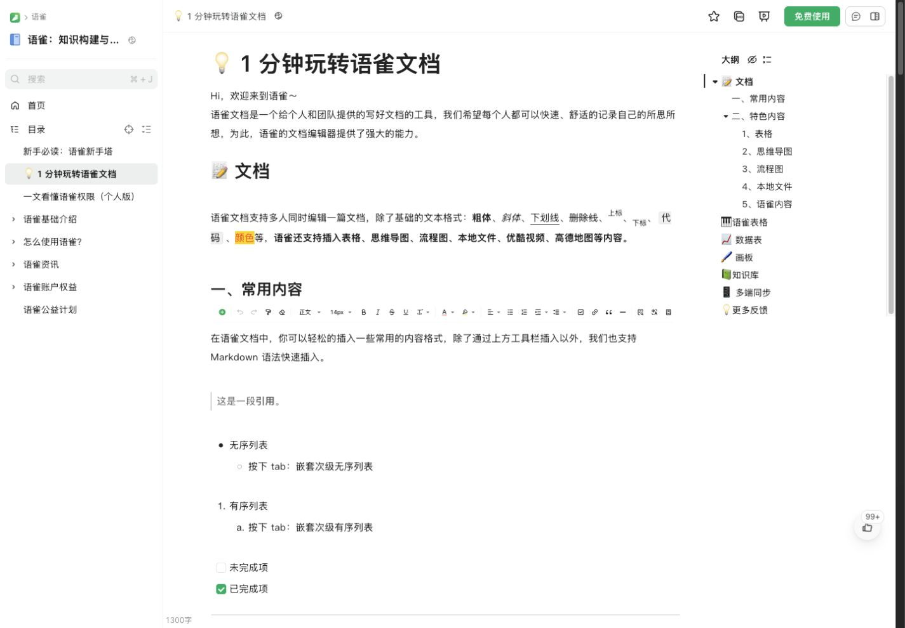
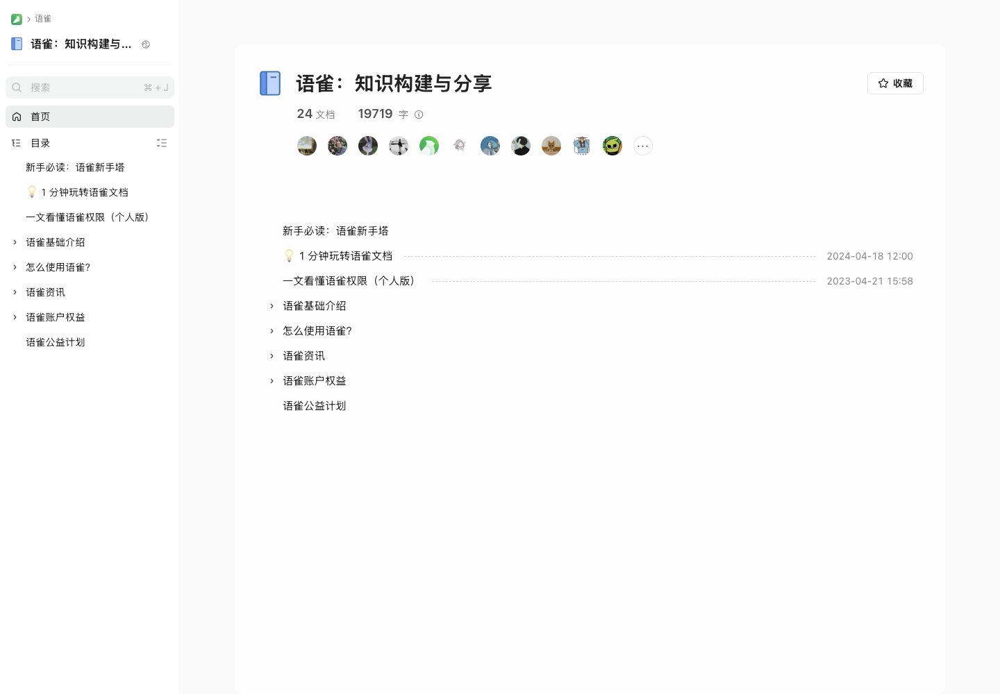
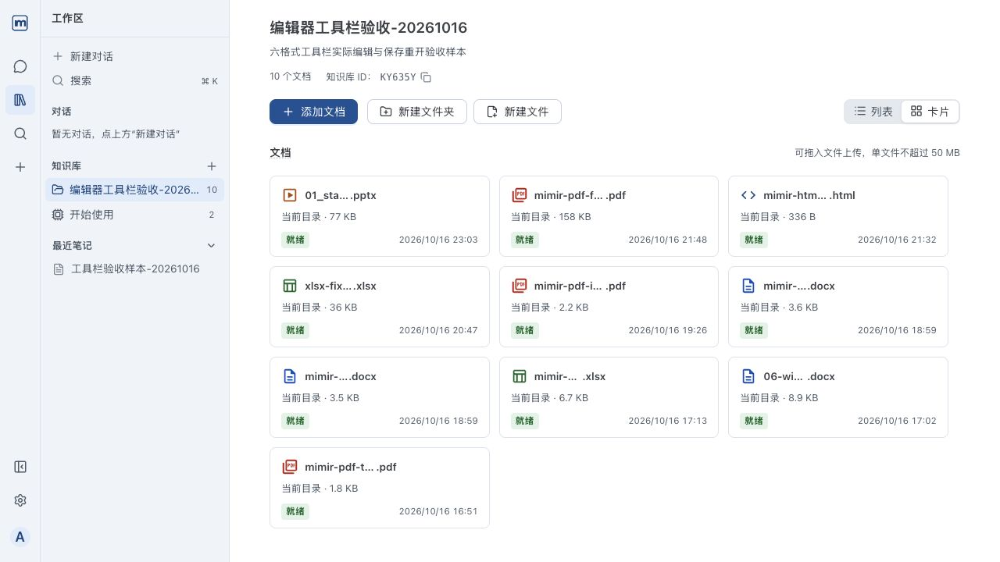
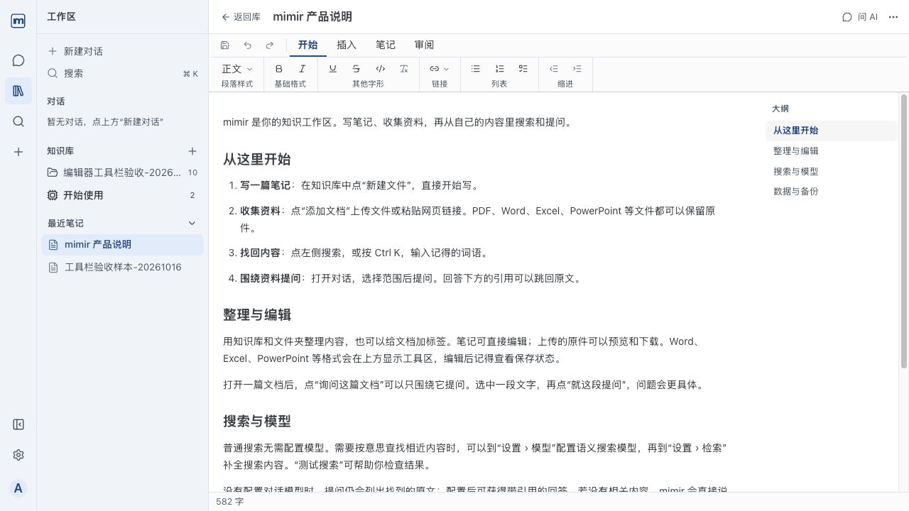
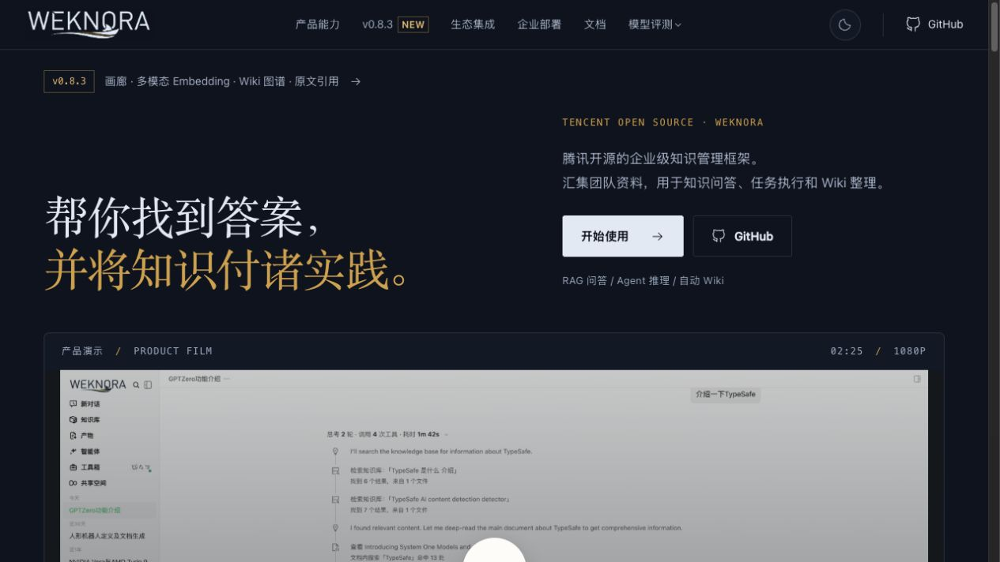
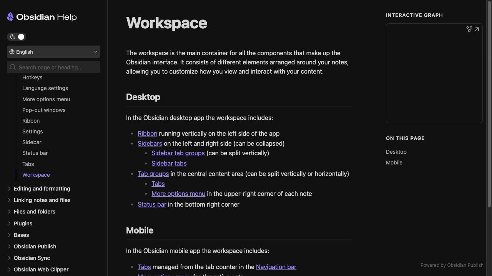

# 语雀设计调研与 Mimir 迁移建议

调研日期：2026-10-16，Asia/Shanghai。后续决策更新：2026-10-17 用户已选择主题、组件、导航和页面布局整体迁移，详见 `../visual-plan.md`；本报告保留调研时的建议与证据边界，未进入实施。

## 1. 结论

建议将 Mimir 的视觉方向改为：**中性白灰工作区、少量绿色关键操作、灰色导航选中态、清楚的中文排版和更从容的内容留白**。

语雀的识别感来自一组共同工作的规则：大部分界面保持中性；导航当前项用灰底和字重；正文与操作区有清楚的空间分工；标题、目录、正文、大纲拥有不同的密度。绿色用量有限。把现有蓝色全部替换为绿色，仍会保留当前冷色表面和密集比例，不能达到同样观感。

本报告以用户此次明确选择的语雀为视觉主参考。Obsidian 用于比较现有功能栏、可折叠侧栏的布局价值；WeKnora 用于知识库和 Agent 的领域行为；Office 编辑命令和能力继续沿用现有 Office / Google Docs / GenOffice 参考边界。

## 2. 证据与访问范围

| 编号 | 本轮检查 | 结果与证据限制 |
| --- | --- | --- |
| Y1 | [语雀公开知识库首页](https://www.yuque.com/yuque/ng1qth) | 已访问、截图、DOM 采样；目录行、分组、时间、标题层级均可见 |
| Y2 | [语雀公开文档阅读页](https://www.yuque.com/yuque/ng1qth/iaxgag) | 已访问、展开目录、截图、测量；正文是历史内容，页面外壳是访问时在线版本 |
| Y3 | [语雀个人工作台入口](https://www.yuque.com/dashboard) | 跳到登录页；未进入个人工作台、设置和实际编辑器，没有将帮助页图片冒充当前编辑器 |
| M1 | 本机 Mimir 知识库 | 已访问现有 admin 会话，截图；未创建账号或测试数据 |
| M2 | 本机 Mimir「mimir 产品说明」 | 已访问、截图；当前笔记打开即处于可编辑状态，包含工具区，与 Y2 的只读角色不同 |
| W1 | [WeKnora 官网](https://weknora.weixin.qq.com/) | 已访问、截图、保存 DOM；导航与发布区显示 v0.8.3 |
| W2 | [WeKnora v0.8.3](https://github.com/Tencent/WeKnora/releases/tag/v0.8.3) 与公开源码 | GitHub API 核对发布时间 2026-10-14T07:53:24Z；源码固定在 tag 对应 SHA `3e22822c1d2397be730c458c7539d0eb8c113a24` |
| O1 | [Obsidian Workspace 文档](https://obsidian.md/help/workspace) | 已访问、截图、保存 DOM；在线文档未标应用版本，不能当作已测试某个桌面版本 |

语雀在线页面未公开可核实的 Web build 版本号，以访问日期标识样本。官网当时的桌面下载链接包含 4.2.1.1333，这只能标识下载包，不能充当本轮 Web 界面的版本。

本轮属于设计研究，未完成语雀登录后的端到端产品审计。未验证语雀深色模式、手机交互、完整 hover / focus / pressed 状态、键盘流程、屏幕阅读器、个人设置和编辑保存。

## 3. 语雀实际观察

### 3.1 阅读页：内容优先的三部分结构

左侧知识库目录、中央正文、右侧文档大纲，各自承担一个任务。左侧包括库名称、搜索、首页、目录和分组；右侧大纲以缩进和细标识呈现当前位置。目录中当前文档使用浅灰底和粗体，常规目录文字保持黑灰。

宽屏样本 1440 × 1000 下，左侧栏测得约 259px；正文段落宽度 750px。左侧栏曾处于收起状态，本轮用边缘展开控件打开后截图；这证明支持展开 / 收起，不据此推导完整响应式断点。

### 3.2 知识库首页：以目录呈现内容

标题、文档数量、字数、协作者信息在上方，目录在下方。文档行与目录分组保持连续；更新时间退到右侧。这里的卡片是容纳整个知识库概览的白色大容器，文档本身没有各自包成独立小卡片。

适用于 Mimir：减少每个文档的视觉包装，强化名称、层级、位置与更新时间的扫读。Mimir 的现有卡片视图仍有价值，是否调整默认视图需要后续单独确定，不能把公开知识库目录直接等同于语雀个人工作台。

语雀的协作者头像、收藏、公开阅读统计符合团队和公开分享场景；Mimir 当前为单用户知识库，不应照搬这些业务信息。

### 3.3 精确采样表

以下为浏览器 `getComputedStyle` 和 DOM 矩形的本次读数，原始证据在 `yuque-dom-samples.json`、`yuque-detail-samples.json`、`yuque-home-samples.json`。它们是对应元素的样式，不宣称为语雀完整官方设计令牌。

| 元素 / 角色 | 本次读数 | 对 Mimir 的含义 |
| --- | --- | --- |
| 阅读页「免费使用」主按钮 | 背景 `#00b96b`，白字，14px / 500，圆角 6px | 品牌绿色与中性背景分工；按钮文本对比度需独立校准 |
| 主文字 | `#262626` | 中性墨黑，去掉现有文字的冷蓝倾向 |
| 当前目录项 | `#eff0f0` 底，`#262626` 字，700 字重，6px 圆角 | 当前项可以由中性底与字重表达，无需整行绿色 |
| 左目录普通文字 | 14px，行高约 22px | 导航可略比现有 13.5px 更易读 |
| 当前目录可点击区域 | 约 34px 高；外层 36px 高 | 给目录行适度呼吸空间 |
| 左侧栏 | 白色，样本宽约 259px | 分栏可以依赖位置和轻分隔，减少有色背景层数 |
| 文档大标题 | 36px / 700，行高约 50px | 与工具区文字拉开层级；不直接推广为所有页面标题 |
| 示例正文段落 | 15px，30px 行高，750px 宽 | 区分 UI 正文与长文阅读字号；该文档设置不能当全站默认值 |
| 知识库首页标题 | 28px / 700，行高约 44px | 知识库标题应与目录行明显区分 |

观察到的间距原则：内容列前后有明显边距，段落、标题与列表分组之间留白清楚；未精确采样全部外边距，不虚构一整套语雀 spacing token。

### 3.4 外观和交互原则

- 页面背景以白和近白中性色为主；分区使用轻分隔，不靠大块品牌色。
- 常驻目录和正文区域保持平面；浮层与登录卡片可用阴影。登录页的阴影不能推广到文档列表。
- 线性图标和文字共同解释功能；文档 emoji 属于内容，不必迁成整个应用的装饰语言。
- 页头操作紧凑，正文排版宽松；操作密度与阅读密度分开设计。
- 绿色品牌操作、灰色当前项、红色错误和其他语义状态应有各自职责。

### 3.5 可访问性校准

用标准 sRGB 亮度公式计算，采样的 `#00b96b` 与白色对比度约 **2.58:1**。对应 14px 白色按钮文字达不到 4.5:1 的普通文本要求。这个事实应作为 Mimir 复刻时的具体调整点。

建议保留亮绿作为品牌识别色，常规白字主按钮采用更深的绿色；示例候选 `#00834d` 对白色约 **4.82:1**，链接候选 `#007a45` 对白色约 **5.43:1**。这些是 Mimir 建议值，**并非语雀实测值**。用户确认方向后再完整校准浅色、深色和交互状态。

## 4. Mimir 现状和差异

| 维度 | Mimir 现状 | 建议迁移 |
| --- | --- | --- |
| 强调色 | 主色 `#245b9e`，链接 `#1d4f8b`，当前项浅蓝 | 少量绿色操作，当前目录优先采用中性灰底与字重 |
| 表面 | 布局 `#e8ecf1`、导航 `#f2f5f9`、列表 `#f8fafc`、内容白色 | 合并不必要的冷色层级，改为白与中性灰 |
| 文字 | `#252b31` 主文字与冷灰辅助文字；共享 14px body | 中性黑灰；UI 保持 14px，阅读内容可另设 15–16px 角色 |
| 形状 | 基础圆角 8px，浮层约 12px | 控件候选 6px；大工作区保持连续，浮层单独控制 |
| 导航 | 52px 功能栏 + 任务侧栏，总展开宽约 294px | 需要确认是否将常用入口并入单一侧栏，或保留现有结构只改外观 |
| 文档展示 | 当前样本使用卡片网格，每项带摘要、状态、时间 | 优先打磨目录 / 列表信息层级；保留文件类型、处理状态等 Mimir 必要信息 |
| 内容宽度 | 已有 760px 内容令牌 | 数值与语雀样本 750px 很接近；重点调整实际内边距和阅读字号，而非盲目扩宽 |
| 编辑区 | 笔记打开即出现分组工具区 | 当前截图与语雀只读页角色不同；是否引入独立阅读模式需后续产品决策 |

现有证据：`apps/web/DESIGN.md`；`packages/renderer/src/theme/tokens.ts`（主色约 104 行，内容宽度 369 行，字体角色 449 行）；`customToken.ts`（浅色 119 行、深色 142 行）；`routes/_app.tsx:79`（展开布局）。后续细化迁移参考 [消费链与迁移风险](migration-code-map.md)。

代码核查还发现三项不能遗漏的收尾工作：导航本地样式存在 `!important`，只改全局 Menu token 不会完成迁移；Web / Desktop 首帧背景独立硬编码，需同步避免旧色闪现；部分 Office 控件使用未接通的旧变量并回退到蓝色 / 紫色，需逐处确认。它们说明迁移范围超过一个主色常量，但无需更换现有组件体系。项目实际安装 Ant Design **6.6.6**；本轮用该版本的 Button token 元数据核对按钮文字、hover、阴影可分别配置，证据在 `antd-button-tokens.json`，未修改组件。

## 5. WeKnora 和 Obsidian 的适用性

### WeKnora v0.8.3

官网本轮明确说明：RAG 回答附来源引用，可打开原文核对；发布区提供「原文引用定位」；Agent 检索资料并调用工具。Mimir 改版时仍需保留来源可识别、引用可点击、处理状态可理解等领域信息，不能因视觉简化丢掉这些能力。

公开源码 [frontend/src/assets/theme/theme.css](https://github.com/Tencent/WeKnora/blob/3e22822c1d2397be730c458c7539d0eb8c113a24/frontend/src/assets/theme/theme.css) 在该 tag 的浅色块定义：`--td-brand-color-4: #07c05f`、`--td-brand-color-1: #e9f8ec`、`--td-bg-color-container: #fff`、`--td-bg-color-sidebar: #f9f9f9`、`--td-font-size-body-medium: 14px`。源码快照为 `weknora-theme.css`。

适用：中性容器与少量品牌强调在知识库产品中可行；知识库和 Agent 的业务反馈需要保留。**WeKnora 绿色与语雀绿色不同**，不混成一组“竞品通用绿”。WeKnora 官网深色金色是营销页视觉，不作为 Mimir 工作区主题参考。未运行 WeKnora，本段不等同于对其真实应用状态的完整验证。

### Obsidian

本轮 [Workspace](https://obsidian.md/help/workspace) 官方文档明确列出左侧 Ribbon、左右可折叠 Sidebar、中央 Tab groups、右下 Status bar。Mimir 当前「功能栏 + 任务侧栏」结构与这类布局有直接关联，保留它可降低导航迁移成本。

但用户本次明确偏好语雀，所以不能用旧 Obsidian 规范阻止视觉替换。建议把 Obsidian 的布局作为是否保留独立功能栏的比较选项；主题、灰阶和组件观感以用户确认后的语雀方向为准。

### Office

此轮没有重新审计 Office 网页版、Google Docs 或 GenOffice。沿用项目已存在的编辑能力契约；语雀公开阅读文档中的历史工具栏图片不作为六格式 Office 工具栏设计与能力的主要依据。Chat 和 Office 外壳跟随宿主主题，用户文档内的文字、图形、单元格颜色保持内容语义。

## 6. 可落地的设计系统草案

以下均为**建议值 / 建议规则**，不是语雀官方规范，也尚未成为项目现行契约。

| 角色 | 建议起点 |
| --- | --- |
| 品牌识别绿 | 采样 `#00b96b`，用于合适的非文本强调 |
| 主按钮绿 | `#00834d`，白字；待完整状态校准 |
| 强调文字 / 链接 | `#007a45`；链接同时保留形状或下划线提示 |
| 内容背景 | `#ffffff` |
| 辅助工作区背景 | `#f7f8f8` 候选 |
| 导航当前项 | `#eff0f0` + 中性文字 + 600–700 字重 |
| 主文字 / 次要文字 / 元信息 | `#262626` / `#595959` / `#737373` 候选 |
| 控件 / 浮层圆角 | 6px / 10–12px 候选 |
| UI 正文 / 阅读正文 | 14px / 15–16px 候选；独立角色 |
| 阅读标题 | 28–36px 按文档与页面角色区分 |
| 长文行高 / 宽度 | 约 1.8–2.0 / 现有 760px 起步 |
| 常驻表面阴影 | 不增加；浮层单独处理 |

间距继续使用已有 4 / 8 / 16 / 24 / 32px 基础节奏，先校正布局关系。深色模式应同阶段建立中性灰阶和独立绿色状态，不直接取反；语雀深色样本目前缺失，不能宣称像素级复刻。

## 7. 建议推进顺序

1. **确认复刻范围**：只迁主题与组件外观，或同时调整左导航、知识库页面和文档布局。
2. **补参考与做静态方案**：优先知识库、文档、设置三个代表页面；若追求个人工作台 / 编辑器高保真，需要补语雀登录态的当前证据。此步骤仍可不改产品代码。
3. **建立令牌与状态表**：颜色、文字角色、尺寸、焦点、禁用、选中、悬停；同时覆盖浅深外观。
4. **共享外壳试点**：主题 → 导航 → 知识库 → 文档；用相同任务与视口做前后对照，避免只验证色块。
5. **扩到 Chat / Office / Desktop**：统一外观，保留真实能力和平台差异，核对主题桥和弹层。
6. **更新现行规范与验证**：代码、`apps/web/DESIGN.md`、设计 sidecar 和 `.trellis/spec/project/design.md` 同步；保留 AA 与交互可达性底线。

## 8. 当前建议与待决策

推荐后续把**主题、基础组件、左导航和知识库 / 文档布局一并向语雀靠近**，保留 Mimir 的产品名称、知识库 / Agent 功能与 Office 能力。这样才会形成一致的界面气质。代价是导航和页面结构的验证范围明显大于单纯换色。

较小方案是保留 52px 功能栏与现有页面结构，只迁颜色、字体、圆角和状态。改动少，但布局与密度仍会更接近当前 Mimir。

2026-10-17 用户选择上述推荐范围。页级适配方案见 [页面规划](../visual-plan.md)：保留笔记直接编辑与现有列表 / 卡片偏好，深色作为 Mimir 的独立校准设计，不新增阅读 / 编辑模式切换。

当前只新增任务文档与调研证据，任务保持 `planning`；未修改产品代码，未运行 `task.py start`。
