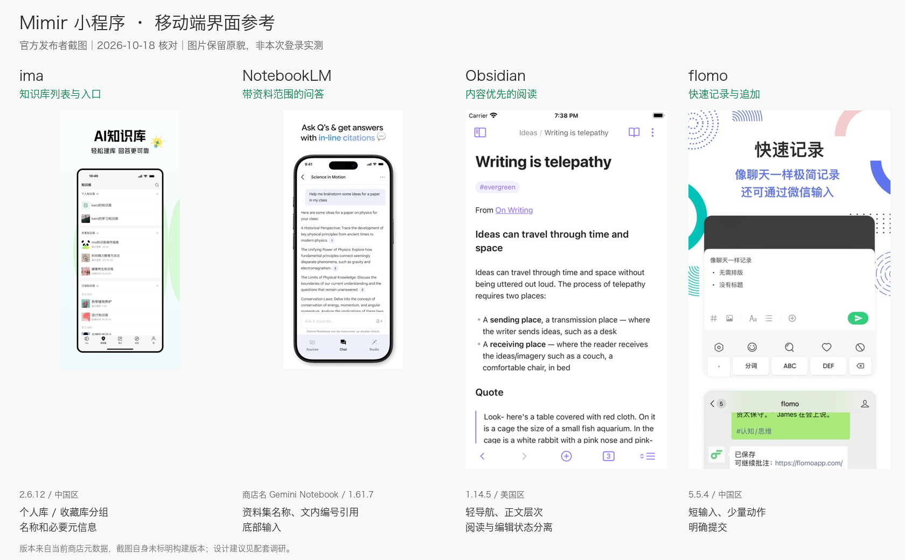
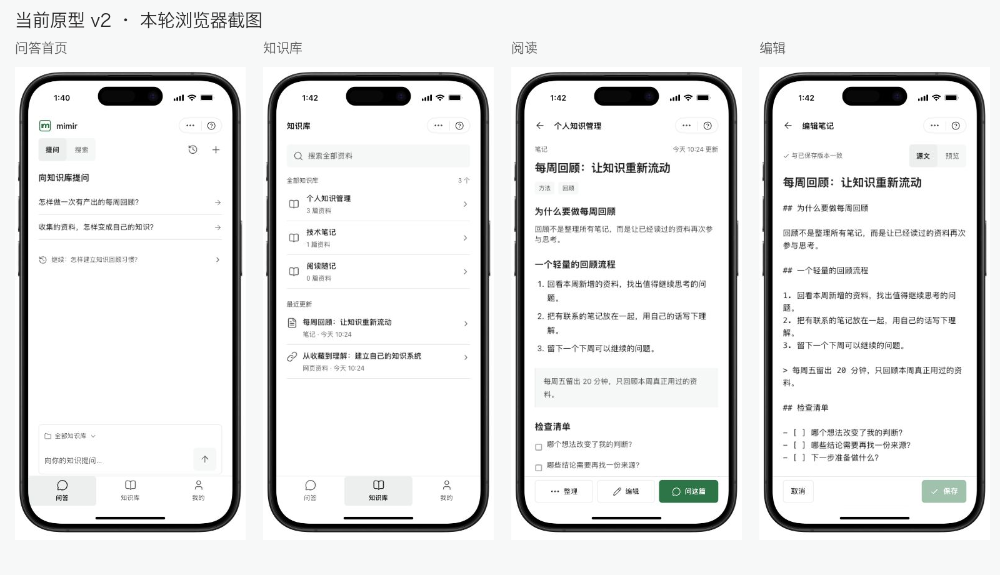

# 微信小程序界面参考调研

日期：2026-10-18。面向自用的知识库小程序，研究下一轮原型的界面和交互打磨；不扩大已确认 MVP，不改动现有原型或生产代码。技术栈保持 Taro 4.3.0 / React 18 / NutUI React Taro 4.0.0-beta.10。

## 结论

推荐组合：**ima 的知识库组织 + NotebookLM 的资料问答关系 + Obsidian 的阅读 / 编辑工作面 + flomo 的快速追加**。Readwise Reader 作为正文与上下文操作的补充参考。保留 Mimir 现行白灰工作面、绿色主操作、中性选中、紧凑列表；Obsidian 主要承担布局参考，不将其紫色主题、插件和命令系统带进小程序。

当前 v2 已经有文内引用、单篇问答、两行资料列表和独立阅读 / 编辑状态，方向成立。下一稿最值得调整的是导航层级、引用定位和动作主次；不需要继续普遍缩字、缩间距，也不需要为了填满屏幕增加功能卡片。

上图使用发布者提供的 App Store 原图，等比缩放并保留营销文案；不是本次登录实测，也不是 Mimir 设计稿。版本来自本轮商店元数据，截图自身未标明构建版本，不能保证画面对应当前客户端版本。

## 研究方法与可信度

- 本轮实际查看当前浏览器原型的首页、知识库、阅读、编辑、回答及引用面板，保留原始截图；只操作模拟资料。
- 下载并逐一查看 5 款产品共 27 张发布者手机截图，记录发布者、App ID、地区、当前版本、更新时间、图片地址及 SHA-256。原始证据见 [商店素材清单](interface-references/appstore-manifest.json)，每款产品另有 metadata JSON 和完整截图图集。
- 查看 Obsidian 移动端官网、ima 公开网页、flomo 官网，并核对 flomo 快速记录帮助、WeKnora 官网与固定版本小程序 README。没有登录竞品账号、安装手机 App 或验证竞品真机交互。
- 因此，下文“观察”只陈述画面 / 官方说明能证明的事实；“借鉴”是对 Mimir 的设计建议，不是用户效果或行业最佳实践的实验结论。

## 候选产品与适用边界

| 产品与本轮版本 | 观察证据 | 对 Mimir 最有用的部分 | 不带入首版的部分 |
| --- | --- | --- | --- |
| [腾讯 ima](https://apps.apple.com/cn/app/id6737188438)，中国区 2.6.12，2026-09-28 更新 | 发布者 Tencent；[图 3](interface-references/ima-store-03.jpg) 为知识库列表，图 1 / 6 为问答画面，图 5 为写作。知识库名称与必要信息组成窄行，按个人 / 共享 / 订阅等分组 | 最接近“搜、读、问、写”组合的功能参照。采用知识库 → 资料 → 正文的可见层级，资料图标和主次文字便于扫读；一屏清楚呈现库与资料身份 | 发现广场、共享 / 订阅知识库、copilot、录音、生图及 AI 写作。它们不在 Mimir 首版范围内；也不照搬 ima 的五项主导航 |
| [NotebookLM](https://apps.apple.com/us/app/id6737527615)，美国区同一 App ID 本轮商店名为 **Gemini Notebook**，1.61.7，2026-10-12 更新 | 发布者 Google；[图 2](interface-references/notebooklm-store-02.jpg) 为资料集列表，[图 5](interface-references/notebooklm-store-05.jpg) 为命名资料集中的问答，正文带数字引用，输入区提示资料数量；商店说明确认来源内联引用 | 回答始终有明确的资料上下文，编号引用靠近对应结论，核对来源与继续提问形成连续任务。Mimir 继续保留唯一可编辑的范围入口，不增加第二个范围选择器 | Audio Overview、Studio、自动生成学习内容、多色资料集卡片。截图不能证明引用点击后的精确交互，本轮不据此声称其支持哪种引用抽屉 |
| [Obsidian Mobile](https://obsidian.md/mobile)，[美国区商店](https://apps.apple.com/us/app/id1557175442) 1.14.5，2026-10-09 更新 | [图 2](interface-references/obsidian-store-02.png) 浅色正文页；[图 4](interface-references/obsidian-store-04.png) 键盘上方的编辑工具；[图 5](interface-references/obsidian-store-05.png) 文件导航 | 页面布局主参照。正文直接放在工作面，标题 / 小节 / 引用有清楚层次；编辑时才出现相关工具，文件导航收起后给内容完整空间 | 插件管理、命令面板、多标签工作区、图谱与复杂自定义工具栏。其无文字底栏图标对熟练用户友好，但 Mimir 应保留关键动作文字 |
| [flomo](https://flomoapp.com/)，[中国区商店](https://apps.apple.com/cn/app/id1552314395) 5.5.4，2026-09-24 更新 | [图 5](interface-references/flomo-store-05.jpg) 快速输入；[官方帮助](https://help.flomoapp.com/basic/quick-input.html) 明确采用聊天式输入，减少标题与排版负担；文档同时明确不做 Markdown 编辑 | 追加笔记、补一段想法采用轻量输入，当前目标可见，少量工具与明确提交动作。已有笔记追加时不重复填写标题、目录、标签 | 不把卡片笔记流替代知识库文档体系，也不用其编辑器替代 Mimir 已确认的 Markdown 源文 / 预览；每日回顾、统计、语音、AI 洞察不增加到本轮范围 |
| [Readwise Reader](https://readwise.io/read)，[美国区商店](https://apps.apple.com/us/app/id1567599761) 8.25，2026-10-08 更新 | [图 2](interface-references/reader-store-02.png) 高亮段落与相关操作；图 3 展示阅读中的辅助面板 | 补充参考：原文核对时突出命中段落，操作靠近内容，避免正文被常驻工具打断。保留原件、网页与笔记的身份区别 | 不引入 RSS、稍后读队列、朗读、原件高亮回写或 Ghostreader 改写；商店截图里的旧模型名也不作为当前模型能力证据 |

## WeKnora 复核与适用性

按项目要求，本轮再次核对 [官网](https://weknora.weixin.qq.com/)（HTTP 200，v0.8.3）和 [公开小程序 README](https://github.com/Tencent/WeKnora/blob/3e22822c1d2397be730c458c7539d0eb8c113a24/miniprogram/README.md)（HTTP 200）。固定版本为 **v0.8.3**，commit `3e22822c1d2397be730c458c7539d0eb8c113a24`。README 支持知识库选择、问答、URL 入库等已有产品研究结论。本轮 `app.json` raw 请求超时，不将其计作成功；此前固定源码证据保留在主调研中。

WeKnora 继续作为知识库范围、问答与来源职责的主要领域参考。官网的“原文引用定位”是其产品层能力说明，不能直接视为开源小程序已具备同样交互。本次不把桌面并排预览、Wiki 图谱或 Markdown 编辑器工具栏搬入手机，也不以它替代 Obsidian / Mimir 现行布局与视觉契约。具体源码与 API 边界仍以 [主调研](miniapp-product-research.md) 为准。

## 当前原型对照

原始截图分别保留为 `mimir-current-home.png`、`mimir-current-library.png`、`mimir-current-reader.png`、`mimir-current-editor.png`；对照图只裁掉浏览器评审外壳并等比排版，不修改手机内容。

| 当前观察 | 判断与下一稿建议 | 优先级 |
| --- | --- | --- |
| 首页同时显示品牌导航、提问 / 搜索切换、历史 / 新建、引导标题、示例问题和继续入口 | 已经简洁，但操作层级仍偏平均。统一顶栏身份；常用动作位置固定；继续已有会话比泛化示例更突出。新用户保留两条有用示例，已有内容时优先帮助继续工作；不增加统计或宣传模块 | P1 |
| 知识库、资料列表已是两行窄行，阅读页直接呈现正文 | 保留结构。下一稿细化名称、文件类型 / 来源、更新时间的主次，统一文件类型图标、分组间距和对齐；不恢复大型知识库封面卡片，也不把阅读正文塞进卡片 | P1 |
| 回答已有文内编号；点击“引用 1”打开包含全部两份来源的同一面板，未突出本次点击的来源 | 将“某个编号的来源”和“全部参考资料”区分：点编号先定位对应条目并突出命中片段，全部来源入口保留列表。保留返回回答位置；不把原件跳页说成已支持。该建议来自本轮实际点击和 [引用面板截图](interface-references/mimir-current-citation.png) | P1 |
| 引用面板在每份资料下重复“保留命中片段及上下文，便于核对来源” | 删除这种描述实现意图的常态说明，直接展示来源名称、必要身份、命中原文和“打开原文”。来源定位明确后，尽量缩短从结论到原文的路径 | P1 |
| 阅读底部“整理 / 编辑 / 问这篇”三个按钮并排，编辑页已有状态与源文 / 预览 | 阅读中优先保留“问这篇”和轻量编辑入口，整理进入次级菜单；明确区分只读原件、可编辑笔记。继续保留显式保存、未保存状态和冲突保护，不照搬 flomo 的无标题模型 | P2 |
| 编辑页主要为整篇 Markdown；快速追加与全文编辑的任务重量不同 | 全文编辑继续独立页面；追加笔记可使用带目标名称的轻输入面板，减少重复元信息表单。只优化已有追加能力，不新增 AI 改写或复杂富文本工具栏 | P2 |

额外发现：本轮回答 / 引用状态的两处 `/mimir.svg` 在浏览器中显示为破图，DOM 图片就绪检查也未通过，前面的首页截图中曾正常显示。将资产加载修复列入下一轮原型质量项，不从该现象推导产品信息架构问题。本轮未修改或重启原型服务。

## 建议的下一稿方向

1. **知识库工作台**：沿用现有三入口、轻顶栏、紧凑两行列表。名称承担主视觉，类型与时间退到辅助层，绿色集中用于主动作；字体、触控尺寸与正文行距保持可读，不普遍缩小。
2. **可核对的回答**：延续 NotebookLM 的资料上下文关系和现有编号引用；先优化点击某一条引用后的定位、片段层次、打开原文及返回位置，不重复设计已经存在的引用功能。
3. **安静的阅读与编辑**：正文采用 Obsidian 的工作面逻辑，工具按状态出现；快速追加借鉴 flomo，整篇 Markdown 编辑仍保留源文 / 预览与显式保存。

候选视觉基线：沿用白灰表面、绿色主动作、6px 控件圆角；阅读标题 22px、正文 15px / 1.8、常用触控区至少 44px。上述数值来自 Mimir 当前原型，不是测量竞品截图得到的规范。NutUI 负责 Popup / Dialog / Form 等通用交互，业务页面不采用其完整演示页模板。

这些是下一稿提案，尚未修改 PRD、正式技术方案或原型，也没有将新的界面方向标为已获用户认可。

## 来源与限制

- [官方截图清单和哈希](interface-references/appstore-manifest.json)，另有各产品 `*-metadata.json` 与 `*-contact-sheet.jpg`。Google 产品本轮名称以商店实际返回为准，不仅凭旧称推断品牌更名时间。
- [公开资料获取记录](interface-references/public-sources-manifest.json)：保留响应哈希、文字快照哈希与失败记录。Obsidian Help 本轮返回客户端壳，正文证据使用商店截图及已有固定帮助源码研究，不把 HTTP 200 当作读到了完整帮助内容。
- ima 网页出现微信登录弹窗，本轮未登录；NotebookLM 官网浏览器导航超时，Google 博客获取超时，改用核实发布者为 Google 的官方商店素材。Readwise 官网页面曾成功读取，持久化复取时超时，因此其可交付视觉证据以商店素材为准。
- 公开截图能证明画面中的层次与控件位置，不能证明当前真机触控、手势、键盘避让、无障碍焦点、网络恢复或完整引用路径。竞品手机 App 与微信小程序也有系统导航差异，实施时需重新验证。
- 本轮通过 Product Design 的研究 / 来源捕获流程和 Impeccable 的现有界面约束组织调研；未生成新设计、未调用模型做图片再创作，也未发布外网。
