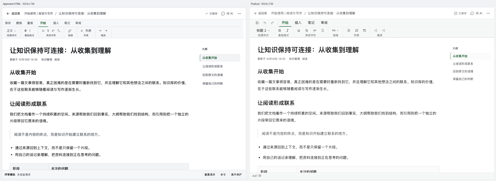

# 产品浏览器实测

批准稿：document-review-v1，哈希保持不变。78组422状态已逐项映射源码；以下仅为实际抽验，不代表422次GUI通过。

使用真实Renderer及临时Fetch响应夹具对齐批准稿内容；PATCH成功/失败均拦截，没有写入真实笔记。验收结束已清除拦截和尺寸覆盖、恢复浅色，并重载真实“mimir 产品说明”。

| 场景 | 观察结果 |
|---|---|
| note-desktop | 同内容笔记：48px头部、28px标题、15px/1.9正文、32px内边距、196px大纲；双链与正文共用滚动区。 |
| title-cancel | 显式编辑/取消，回到标题入口；未写真实API。 |
| title-read-recovery | 冷刷新后拦截PATCH200/GET404；禁用标题并仅重试GET，恢复后回焦，活正文保留。 |
| tags-failure | 拦截标签PATCH500，保留失败候选并提示重试。 |
| submenu-escape | ArrowRight展开标签；第一层Escape回父菜单，第二层关闭并回焦更多操作，expanded=false。 |
| narrow | 390px无页面横溢；标题25px/35px、正文28/16/48内边距，无大纲。 |
| assistant | 390px覆盖层left84,width306；焦点在关闭按钮，aria-modal；Escape回入口；隐藏保留挂载且inert。1100px视口/844px实际文档栏仍覆盖400px。 |
| low-height | 1280×480正文内部滚动，头部/工具区固定，命令动作可达。 |
| dark | 实际账户主题切换深色核对；随后恢复浅色。 |
| command | 桌面480px弹窗/24px内边距/17px标题；最终390px left62,top24,width318,padding18,radius12,title15；取消关闭。最后清除窄屏margin-block抵消8px偏移。 |
| readonly | 只读抓取正文、单一H1与来源链接；http(s)、blank、noopener noreferrer。 |
| media-error | 图片请求404进入明确失败下载卡片，下载名称说明已保存原件。未证明成功解码或下载完成。 |

## 同内容对照

[本地HTML证据页](implementation-browser/review.html)。批准稿1024×720画布，对照1280×720产品中的1024px文档栏；同标题、正文、标签、更新时间和链接。参考截图包含外置评审模拟条；产品包含真实字数条。Office工具栏在批准稿中为示意，本轮保留真实Office工具，不宣称内部工具或每个像素完全相同。正文列表由真实Tiptap节点渲染。

## 未验证边界

原生音视频播放/拖动/全屏、下载落盘完成、OS中文输入法、读屏、Electron、真实后端写入和各Office内部工具未在本次浏览器抽验中执行。相关组件回归不等于这些宿主验证。没有给未执行的状态标GUI通过。
